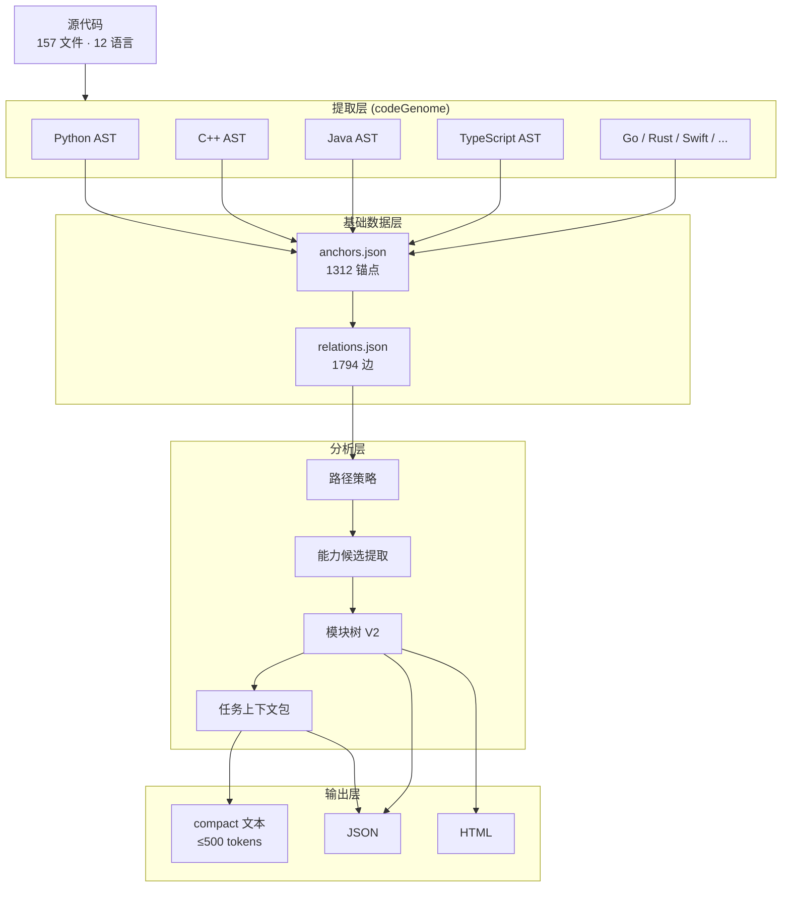

# CodeDendrite: 基于 AST 的代码因果导航系统

**用静态分析替代向量搜索，让 7B 小模型也能精确理解项目结构。**

---

## 重构验证能力

以本仓库自身为例，一次整树重组 + 文件拆分：

| 项 | 数值 |
|---|---|
| 规模 | 47,653 行 · 175 文件 · 2,320 anchor · 5,143 边 |
| 改动 | 文件路径 100% 变更 · 428 条 import 重写 · 42 个文件拆分为 104 个具名块 |
| 耗时 | **1 分 00 秒**（流水线脚本化后；首次含调试为 21 分） |
| 验证 | anchor symbol 丢失 **0**；`call` / `dataflow` / `inherit` / `dispatch` 边 **一根不差** |

```
                  合并源        重构后        判定
anchor symbol     2,185         2,185         丢失 0
call              2,409         2,409         ✓
dataflow          2,409         2,409         ✓
inherit              87            87         ✓
dispatch             52            52         ✓
impact              106           108         合成的 risk 排名，随语料重排
```

关键不在快，在于**可判定**。

改完 428 条 import、拆散 42 个文件之后，凭什么说没弄坏？跑测试只能覆盖测试到的路径。
有了 `anchors.json` + `relations.json` 作基线，答案是逐条可比对的：**5,063 条边搬完还是 5,063 条，
少一条能指出是哪一条**。重构过程中确实丢过 153 条边——按行数顺序切分把同文件调用切散了，
`_call_name` 这类项目内有 4 处同名定义的符号无法消歧——正是靠逐边比对定位并修复的。

> 说明：这是**人指挥 + LLM 执行 + anchor 索引验证**的流程，不是一键工具。

---

## 源码来源

本树由两个上游合并而成：

| 取自 | 内容 |
|---|---|
| `para-llm/tools/CodeDendrite` | `api/anchors.py` 增量更新丢边修复 + `only_ids` 范围收窄；`hash/database.py`、`codeGenome/database.py` 的原子写 + 跨进程 `db_lock` + 写前 rebase；新增 `shared/dblock.py` |
| `WORKSPACE/CodeDendrite` | 其余全部。其中 `bind_core_anchors.py`、`codeAnalysis/visualizer.py`、`parsers/python_parser.py`、`build_map_rewrite.py`、`examples/analyze_any_project.py` **刻意保留此版本**——上游那份把路径硬编码成了 `/Users/yoli/…` 和 `F:/projects/…` |

未迁入：`evaluation/`、`debug_injection/`、`pypi/`、`rl_trace/`、`plugin/`，以及上游 56 个一次性调试脚本。

---

## 目录布局

8 个桶，按依赖层级组织。实测桶间依赖单向率约 95%。

```
├── base/     Anchor 类型 · ID 规则 · 基础设施 · db_lock   16 文件   2,247 行
├── parse/    采集：源码 → 符号（12 语言 AST）            49 文件   8,646 行
├── index/    符号 → anchors.json                        25 文件   4,494 行
├── relate/   → relations.json · 5 类因果边              52 文件   7,343 行
├── synth/    模块树 · 上下文包 · 锚点维护                50 文件  11,584 行
├── view/     可视化                                     24 文件   4,304 行
├── serve/    入口 · CLI · MCP                           35 文件   6,700 行
└── tests/    测试 + fixtures + examples                 28 文件   4,921 行
```

依赖方向：`base ← parse ← index ← relate ← synth ← view ← serve`，`tests` 依赖全部。

**超过 300 行的文件被拆成同名包**，块名由 CDD 自己的 anchor 数据推导：

```
api/anchors.py  (1,979 行)  →  index/api/anchors/
                                 ├── call_site_collector.py        类 _CallSiteCollector + 17 方法
                                 ├── resolve.py                    7 个 resolve_* 函数
                                 ├── generate_all_anchors.py       块内唯一符号
                                 ├── build_effective_methods_table.py
                                 ├── anchors_list.py
                                 ├── core_anchor.py / core_load.py
                                 ├── subscript_string.py
                                 └── __init__.py                   re-export 全部符号
```

命名规则：单一类主导 → 类名；函数共同词根 → 词根；都没有 → 块外引用最多的符号名。
`__init__.py` re-export 全部符号，外部 import 不受影响。

旧路径 → 新路径的完整对照见 [doc/迁移映射.md](doc/迁移映射.md)。

---

## 入口

```python
# 顶层稳定接口（90 项）
from CodeDendrite_refactor import scan_project, create_anchor, load_anchors, PathTracer, AnchorMemory

# 新代码建议直接 import 归属层
from index.api.anchors import load_anchors
from relate.api.relations import generate_relations
from synth.api.module_tree_v2 import generate_module_tree_v2
```

```bash
python -m serve.api.cli --help        # 主 CLI
python -m serve.api.query count .     # 查询命令
```

本树可独立运行，不依赖任何外部包路径。两个上游版本都做不到这一点——
它们的 `from tools.CodeDendrite import ...` 只在 para-llm 仓库根目录下才解析得了。

---

## Known Issues

- **anchor ID 全部变更**：`api/anchors.py::create_anchor` → `index/api/anchors/core_anchor.py::create_anchor`。
  历史 task context、action session、文档锚点需要 ID 别名解析层才能继续用。
  实测 hash + symbol 可唯一命中约 92%，其余靠旧模块映射消歧。
- **约 58 个文件仍超 300 行**，剩余的是单个巨型类，再拆需改动类内部结构（会改 anchor symbol）。
- **3 个测试硬编码旧路径**（`"api/anchors.py::create_anchor"`），重构后失败。
  建议改为按 symbol 查询，使测试对布局变更免疫。
- `serve/mcp_server.py` 需要外部 `mcp` 包，未安装时无法 import（与重构无关）。

### 相对上游修复的问题

| 问题 | 上游状态 | 本树 |
|---|---|---|
| `from tools.CodeDendrite import ...` | 两版共 61 / 35 处，只在 para-llm 根目录可解析 | **0 处**，全部指向归属层 |
| `rebuild` / `cmd_edges` / `cmd_count` | 两版调用均 `ModuleNotFoundError` | **可执行** |
| YAML worker 子进程 | 启动 `-m tools.CodeDendrite.api.yaml_profile_worker`，失败后静默退回 PyYAML | 直接按文件路径执行同目录 worker |
| `code_anchor.anchor_engine` | 包名从不存在，`agent_tools` 静默降级为空工具表 | 指向 `index.codeTree.anchor_engine` |
| `tools.codeAnalysis.*` | 包名从不存在，`codeAnalysis/main.py` 无法 import | 指向 `parse.codeAnalysis` / `view.codeAnalysis` |
| 根包可选导出 | `build_context` 等 6 个 API 从不存在，整行 try/except 失败连累 `PathTracer`、`AnchorMemory` | 改用真实名 `ContextBuilder` / `SymbolExpander` / `NodeReplacer`，导出 90 项（上游 83 项） |
| pytest 收集 | 合并源 3 处收集错误，0 个测试可跑 | **192 passed / 4 failed** |

---

## 总体架构



---

## 核心思路

传统 AI 编程工具用 **RAG + 向量搜索**：把代码切块 → 嵌入向量 → 相似度检索。问题是：

- 丢失了函数间的调用关系
- 检索结果没有因果解释
- 小模型拿到碎片后仍然在猜

CodeDendrite 用 **AST 静态分析**：

- 精确到函数/类/方法级别（不是文本块）
- 自动派生 5 种因果关系（call · dataflow · inherit · impact · dispatch）
- 按 token 预算分层投喂（不是塞一堆代码进去）

**结果：7B 模型拿到 400 tokens 的任务包，就能定位到正确的入口和候选。**

---

## 五种因果关系

| 类型 | 数量 | 含义 | 用途 |
|------|------|------|------|
| `call` | 631 | A 函数调用 B 函数 | 追踪执行路径 |
| `dataflow` | 924 | A 的输出流入 B 的输入 | 追踪数据来源 |
| `inherit` | 75 | 子类继承父类 | 理解类层级 |
| `impact` | 127 | 修改 A 会影响 B | 评估改动影响 |
| `dispatch` | 37 | A 分发/路由到 B | 追踪动态调度 |

---

## 数据流水线

```
源代码 → AST 解析 → 锚点提取 → 关系派生 → 路径策略 → 高层锚点检测 → 模块核生成 → 贪心合并 → 模块树 V2 → 任务上下文包
```

五个阶段：

| 阶段 | 输入 | 输出 | 说明 |
|------|------|------|------|
| 提取 | 源代码文件 | 符号 + 哈希 | AST 解析，精确到行号 |
| 索引 | 锚点 | anchors.json + relations.json | 1312 锚点，1794 边 |
| 分析 | 锚点 + 关系 | 282 能力候选 | 路径策略 + 高层检测 + 打分 |
| 合成 | 候选集 | 30 模块 · 41 边 | 贪心合并 + 四格填充 + 信心评级 |
| 投喂 | 模块树 + 查询 | task_context.json | 四级上下文，compact ~400 tokens |

---

## Module Tree V2

首次扫描即可输出项目级功能块导览图。

**不是**函数聚类 + 猜名字；**是**多证据合成 + 置信度评级。

### 模块四格

每个模块必须回答：

```
what:      这个模块做什么
how:       内部怎么实现的
functions: 关键入口和类
role:      对项目的贡献
```

### 状态与信心

| 状态 | 含义 |
|------|------|
| `core_flow` | 主链路必经模块 |
| `independent_capability` | 可独立调用的能力 |
| `support_utility` | 支撑工具 |
| `dormant` | 休眠/未接线 |
| `uncertain` | 证据不足 |

| 信心 | 条件 |
|------|------|
| A | ≥4 类证据一致 |
| B | ≥3 类证据 |
| C | 2 类证据 |
| D | <2 类证据 |

### 当前仓库实测

```
模块总数: 30
边数:     41
状态分布: 19 core_flow, 11 independent_capability
信心分布: 26 A, 4 B
区域覆盖: 15/15 (100%)
假模块:   0
```

---

## Task Context Packet

给小模型/执行 agent 一个当前任务的窄上下文。

### 四级上下文

| 级别 | 内容 | Token 预算 |
|------|------|-----------|
| L0 | 项目一句话 + 顶层区域 | 30-80 |
| L1 | 当前区域 + 模块摘要 | 100-300 |
| L2 | 0-3 个可信候选 + why + next_command | 300-800 |
| L3 | 源码片段（按需，默认不给） | 按需 |

L2 是证据门，不是候选数量生成器。唯一精确符号/文件才直接给下一步；跨文件匹配返回 `ambiguous` 和 alternatives，不会拿同文件符号补齐。v2 只有 `exact` 关系能升级为导航命令。

### compact 输出示例

```
项目: CodeDendrite: 30 个功能模块 (19 core_flow, 11 independent_capability)
当前区域: api | 提供 create_anchor 等入口能力
任务锚点: api/anchors.py::create_anchor
导航置信: resolved/high | 完整 anchor ID

候选:
  C0 create_anchor [任务目标] → expand api/anchors.py::create_anchor
  C1 Anchor [被任务调用 via call] → expand codeTree/anchor_engine.py::Anchor
  C2 generate_all_anchors [调用了任务 via call] → expand api/anchors.py::generate_all_anchors

边: create_anchor→Anchor(call), generate_all_anchors→create_anchor(call)
```

**总共 ~400 tokens，7B-4K 模型吃完后还剩 3.5K 上下文。**

### Task Package 评测合同

生成、定位和官方结果必须分栏，官方 harness 未完整运行时不会产生 solve rate：

```bash
cdd eval validate report.json
cdd eval summary report.json
```

生成栏、定位栏、官方结果栏各自独立，官方 harness 未完整运行时该报告不含 solve rate。

### 完整 Issue 证据包 v2

让 CDD 直接读取完整 issue，并保留从文本信号到单一动作的证据链：

```bash
cdd issue issue.md <PROJECT_PATH> --compact
```

`task_context_packet_v2` 对同级强证据冲突返回 `ambiguous`，且最多生成一个结构化动作。字段定义见 `schemas/task_context_packet_v2.schema.json`。

v1/v2 共用三条证据通道：只有 `candidates` 可带动作，`alternatives` 和 `boundaries` 只保留证据。v1 缺少 resolution 的投影边统一标记为 `resolution_unavailable`。

离线比较已有任务包运行时使用 `cdd replay <TASKS.json> <RUN_DIR> --output <REPORT.json>`。缺失索引的任务会保持 `null`，不会用后验 anchor 命中补齐。

使用 `cdd snapshot` 保存与 base commit 绑定的每题索引；使用 `cdd issue --session` 和 `cdd action done` 阻止重复动作。

---

## 快速开始

### 全链路生成

```bash
cd CodeDendrite_refactor
PYTHONPATH=. python -m serve.api.cli . --module-tree-v2
```

输出：
```
.codedendrite/capability_candidates.json   # 282 候选
.codedendrite/module_tree_v2.json          # 30 模块 · 41 边
.codedendrite/module_tree_v2.html          # 可搜索导览页
```

### Task Context Packet

```bash
# 人用命令
cdd context create_anchor .
cdd context 'index/api/anchors/core_anchor.py::create_anchor' . --full

# 生成并保存 JSON
PYTHONPATH=. python -m serve.api.cli . --task-context create_anchor

# 直接输出 compact 文本（给小模型用）
PYTHONPATH=. python -m serve.api.cli . --task-context-compact PythonExtractor
```

### 按 YAML 配置展开调用链

`cdd chain --yaml` 会先调用目标项目自己的 YAML 配置加载函数，再用配置值选择注册表、装饰器和动态分派对应的 Anchor。YAML 用于选择链路分支，调用链起点仍由第一个参数指定。与不带 YAML 的“全部候选图”相比，带 YAML 的结果会删除已确定但未选中的分支，因此节点数通常更少。

```bash
# 从真实模块入口展开全部静态可达链路
cd /path/to/project
cdd chain 'main.py::<module>' . \
  --depth 99 \
  --yaml config/runtime.yaml

# 从指定函数开始，只看其下游链路
cdd chain 'code/manager/runtime.py::build_runtime' . \
  --depth 8 \
  --yaml config/runtime.yaml
```

输出头部会显示实际采用的项目加载器、全部激活键；每个由配置选中的节点会显式标注 `[YAML → 注册键]`：

```text
YAML profile: config/runtime.yaml via code/dataset/load_config.py::load_config (12 active registry keys)
YAML selected: answer.parse.normal, cfg.ollama, chat.normal, ...
[2] OllamaProvider*  code/provider/provider.py:362  [YAML → client.ollama]
[1] chat*  code/provider/provider.py:441  [YAML → chat.normal]
[1] trigger_manual*  code/recall/trigger.py:35  [YAML → trigger.manual]
```

说明：

- 使用项目自身已索引的 `config.load`、`yaml.load`、`load_config`、`load_yaml` 或 `parse_yaml` Anchor 解析配置，不写死某个项目路径。
- 若项目加载器因缺少可选依赖而无法导入，安全回退会递归合并 `_BASE_`，再按最终配置选择链路；输出会列出回退方式和被包含文件。
- 支持 `@register` 这类“注册键就是类名”的裸装饰器；配置里的 `YOLOv3`、`CSPResNet` 等名称可直接落到对应 class Anchor。
- class 调用会继续进入 `__init__`；`obj.method()` 会结合局部赋值推断对象类型，避免链路停在类节点。
- `create(cfg)` 这类工厂调用只展开该调用点对应的配置项；配置段内引用的子组件会继续形成父组件到子组件的 YAML 依赖边。
- `main.py::<module>` 表示模块顶层执行入口；先运行 `cdd file main.py .` 可确认入口 Anchor。
- YAML 未提供某项配置时，对应动态分支保留候选，不擅自选择。
- 不带 `--yaml`：展示所有静态候选分支；带 `--yaml`：保留普通调用和 YAML 选中的动态分支。
- 名称后的 `*` 表示该节点由 YAML 选中；`[YAML → key]` 给出选择它的配置键，不表示该函数只能通过 YAML 调用。
- 对 YOLO 这类组件型 YAML，形如 `[from, repeats, component, args]` 的层声明会生成 `YAML component graph`；组件名只有在唯一精确匹配项目内 class Anchor 时才会链接，外部组件显示为 `unresolved`。
- 项目加载器无法导入时会明确显示 `PyYAML.safe_load (fallback)`；不会假装项目加载器执行成功。
- 结果是静态可达链路；反射、运行时生成调用和外部进程调用需要运行时 trace 补充。

### 全部 CLI 命令

| 命令 | 作用 |
|------|------|
| `--module-tree-v2` | 全链路：候选 + 模块树 + HTML |
| `--capability-candidates` | 只生成候选集 |
| `--module-tree-v2-html` | 只渲染 HTML |
| `--module-tree-v2-check` | 检查完整性报告 |
| `--path-policy-check PATH` | 检查路径角色 |
| `--task-context QUERY` | 生成任务上下文包 |
| `--task-context-compact QUERY` | 输出 compact 文本 |

---

## 锚点数据结构

```python
@dataclass
class Anchor:
    id: str              # "file.py::symbol" 唯一标识
    symbol: str          # 符号名
    file: str            # 相对路径
    line_start: int      # 起始行
    line_end: int        # 结束行
    hash: str            # 结构哈希（秒级变更检测）
    callers: List[str]   # 调用者
    callees: List[str]   # 被调用者
    symbol_type: str     # function / class / method
    drift: str           # ok / stale / missing_symbol / missing_file
    # ... 继承、数据流、AI 记忆等字段
```

---

## 项目结构

见上方 [目录布局](#目录布局)。原先的 `api/ codeGenome/ codeTree/ …` 21 个平级目录已按
依赖层级重组为 `base / parse / index / relate / synth / view / serve / tests` 八个桶，
旧路径 → 新路径的逐文件对照见 [doc/迁移映射.md](doc/迁移映射.md)。

输出目录不变：

```
.codedendrite/
├── anchors.json
├── relations.json
├── module_tree_v2.json
├── module_tree_v2.html
├── task_context.json
└── capability_candidates.json
```

## 关键技术数据

| 指标 | 数值 |
|------|------|
| 支持语言 | 12 种（Python/Java/C++/TS/Go/Rust/Swift/Kotlin/Ruby/PHP/HTML/C#） |
| 锚点总数 | 1312（537 function + 647 method + 128 class） |
| 关系总数 | 1794（924 dataflow + 631 call + 127 impact + 75 inherit + 37 dispatch） |
| 源文件数 | 157 |
| 模块数 | 30（19 core_flow + 11 independent_capability） |
| 区域覆盖 | 15/15 (100%) |
| 模块树 JSON | ~99KB |
| 任务包 compact | ~400 tokens |

---

## 与 RAG 向量搜索的对比

| 维度 | RAG + 向量搜索 | CodeDendrite |
|------|---------------|-------------|
| 粒度 | 文本块 | 函数/类/方法 |
| 关系 | 无 | 5 种因果边 |
| 可解释性 | 相似度分数 | 证据链 + 置信度 |
| 增量更新 | 全量重建 | hash 增量检测 |
| 小模型投喂 | 原始代码片段 | 分层预算 compact 文本 |
| 模型依赖 | 需要 embedding model | 纯静态分析，零模型依赖 |

---

**License:** MIT
**更新:** 2026-04-25
