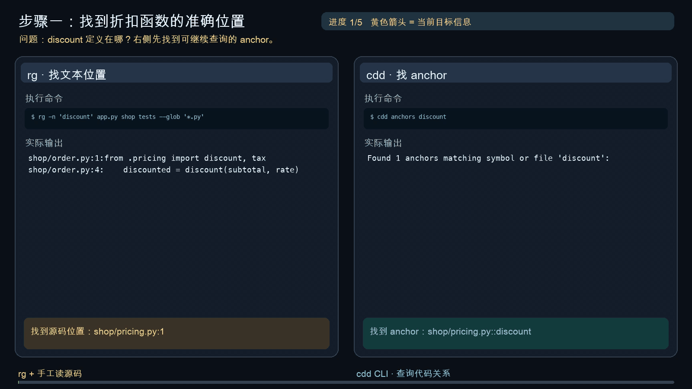

English | [简体中文](README.zh-CN.md)

<h1 align="center">CodeDendrite</h1>
<h3 align="center">Code navigation where every edge is a call that exists in the code.</h3>

<p align="center">
  <a href="LICENSE"></a>
  
  
  <a href="#install-in-one-line"></a>
</p>

<a id="install-in-one-line"></a>

### Install in one line, then ask your agent

```bash
npx skills add lo2589/Code-Dendrite        # 3 agent skills: understand · learn · rebuild
pip install git+https://github.com/lo2589/Code-Dendrite   # the cdd command (Python ≥ 3.10, no dependencies)
```

Then tell your agent:

```text
Use cdd-understand to show me how <your entry function> works in this repo.
```

## CLI demo: rg vs cdd



The same coding task is shown side by side: `rg` on the left and `cdd` on the right. The animation plays directly in this README.

**Static analysis instead of vector search.**

Retrieval finds code that *looks alike*. Navigation needs code that is *connected*. A function that calls yours looks nothing like yours in text — which is exactly where similarity search is bound to fail on call-chain questions. CodeDendrite doesn't guess at similarity: it parses a repository into a graph of causal edges and lets you walk along them.

---

## Status

| Item | Value |
|---|---|
| Layout | Five layers under `src/`; `mcp/` and `skills/` sit next to `src/` |
| Requirements | Python ≥ 3.10; the core uses the standard library only |
| Parsing | Python through the standard-library `ast` module; every other language through lightweight, dependency-free pattern-matching adapters, so their symbols and call edges are heuristic. Depth per language: [language support matrix](#language-support-matrix) |
| Index | Not committed to git. After cloning, run `cdd rebuild` first; see counts with `cdd count` / `cdd status` |

---

## Installation

**Option 1: run from source (no install)**

```bash
git clone https://github.com/lo2589/Code-Dendrite
cd Code-Dendrite
python3 src/usage/cli/cdd rebuild . --virtual     # build the index first: every read command except peek needs it
python3 src/usage/cli/cdd count
```

`src/usage/cli/cdd` puts `src/` on the subprocess `PYTHONPATH` by itself; no extra setup is needed.

**Option 2: install as the `cdd` command**

```bash
pip install .                 # use pip install -e . for development
cdd rebuild /path/to/project --virtual
```

**Optional dependencies** (declared in `pyproject.toml`):

```bash
pip install '.[mcp]'          # the MCP server needs the mcp package
pip install '.[test]'         # running the tests needs pytest
```

**MCP server**: once `mcp` is installed, add this to `.mcp.json`:

```json
{
  "codedendrite": {
    "command": "python3",
    "args": ["/path/to/Code-Dendrite/mcp/server.py", "--root", "/path/to/project"]
  }
}
```

The project that `--root` points to must have been indexed with `cdd rebuild`.

**lens plugin** (optional, only useful with DeepSeek Harness): `lens/scripts/install.sh`. Override the harness repo path, profile and port with `DSH_REPO`, `PROFILE` and `DSH_PORT`. The node path and the harness restart script inside the script are hard-coded to the author's machine; edit those two lines before using it elsewhere.

---

## Layout

| Path | Contents |
|---|---|
| `src/scanner/` | **Language scanner**: source → symbols / line numbers / imports / call sites. `language/` (23 extensions routed by file extension across 23 LanguageSpecs — actual capability depth per spec is measured by the [language support matrix](#language-support-matrix) below; 17 specs reach call-edge depth, 3 stop at symbol detection, 3 are recognized but not parsed), `calls/`, `hashing/`, `project/`, `store/`, `structure/` |
| `src/analyzer/` | **Analyzer**: symbols → anchor identity + causal edges. `identity/` (structural hashing and drift), `anchors/`, `inherit/`, `dataflow/`, `dynamic/`, `path/`, `control_flow/`, `ui/`, `shared/` |
| `src/api/` | **Query surface**: `inspector/`, `navigator/`, `query/`, `relations/` |
| `src/usage/` | **Usage surface**: `cli/`, `packets/`, `workflow/`, `profiles/`, `tools/`, `repair/`, `structure/`, `analyze/` |
| `src/view/` | **Visualization**: `browser/`, `code_map/`, `relations/`, `timeline/`, `module_tree/`, `pipeline/`, `html/` |
| `lens/` | DSH plugin `dsh-cdd-lens`: a session trajectory sidebar + an interactive anchor graph (a node package, independent of `src/`) |
| `lens-pcb/` | A parallel branch of lens (PCB-style layout) with its own build stamp |
| `mcp/` | MCP server: exposes the layers above as tools |
| `skills/` | Three agent skills: `cdd-understand` (understand a project), `cdd-rebuild` (topology refactoring), `cdd-learn` (layer-by-layer guided learning) |
| `src/tests/` | Tests and fixtures |

Dependency direction: `scanner` → `analyzer` → `api` → `usage` / `view`. `scanner` and `analyzer` import nothing above them. One reverse dependency remains: `api/query/cmd_chain.py` imports `view.relations`, `view.timeline`, `view.code_map` and `usage.profiles.yaml_profile` inside functions (4 imports). Modules that used to sit in the wrong layer have moved, so `scan_project`, `debug_workflow`, `generate_module_tree`, `smart_analyze` and the navigator (`start`, `jump`, …) are imported from `usage`, and `generate_mermaid_for_project` from `view.html.graph`, not from `api`.

---

<a id="call-chain"></a>

## From entry point to implementation

The entry point is `mcp/server.py::call_tool`. Once the index is built, one command drills it down to the implementation layer:

```bash
python3 src/usage/cli/cdd chain "mcp/server.py::call_tool" --depth 5
```

The chain crosses three layers: mcp → usage → analyzer. The output is a **tree expansion**: a function called from several places is printed once at each place, so "lines" and "distinct functions" are two different numbers:

| Layer | Lines | Distinct functions |
|---|---:|---:|
| `mcp/` | 15 | 10 |
| `src/usage/` | 36 | 13 |
| `src/analyzer/` | 4 | 1 |
| Total | **55** | **24** |

The most repeated function is `_anchor_attr` (14 times). Full output (all 55 lines):

```
Chain from 'mcp/server.py::call_tool' (55 entries, direction=down):

[0] call_tool  mcp/server.py:294
  [1] tool_context  mcp/server.py:84
    [2] _anchors  mcp/server.py:47
      [3] load_anchors  src/analyzer/anchors/core_load.py:33
    [2] _relations  mcp/server.py:54
    [2] _module_tree  mcp/server.py:62
    [2] resolve_task_anchor  src/usage/packets/task_context_packet/anchor.py:113
      [3] _anchor_attr  src/usage/packets/task_context_packet/anchor.py:54
      [3] _bounded_matches  src/usage/packets/task_context_packet/anchor.py:78
        [4] _anchor_attr  src/usage/packets/task_context_packet/anchor.py:54
      [3] _match_sort_key  src/usage/packets/task_context_packet/anchor.py:68
        [4] _anchor_attr  src/usage/packets/task_context_packet/anchor.py:54
        [4] _is_test_file  src/usage/packets/task_context_packet/plugin.py:119
    [2] build_level0  src/usage/packets/task_context_packet/anchor.py:275
      [3] _anchor_attr  src/usage/packets/task_context_packet/anchor.py:54
    [2] build_level1  src/usage/packets/task_context_packet/anchor.py:336
      [3] _find_anchor_area  src/usage/packets/task_context_packet/anchor.py:328
        [4] _anchor_attr  src/usage/packets/task_context_packet/anchor.py:54
      [3] _find_anchor_module  src/usage/packets/task_context_packet/plugin.py:123
    [2] build_level2  src/usage/packets/task_context_packet/anchor.py:422
      [3] _build_edge_indexes  src/usage/packets/task_context_packet/anchor.py:250
      [3] _score_related_symbol  src/usage/packets/task_context_packet/anchor.py:391
        [4] _anchor_attr  src/usage/packets/task_context_packet/anchor.py:54
      [3] _anchor_attr  src/usage/packets/task_context_packet/anchor.py:54
      [3] _find_anchor_module  src/usage/packets/task_context_packet/plugin.py:123
  [1] tool_symbol  mcp/server.py:112
    [2] _anchors  mcp/server.py:47
      [3] load_anchors  src/analyzer/anchors/core_load.py:33
    [2] _relations  mcp/server.py:54
    [2] resolve_task_anchor  src/usage/packets/task_context_packet/anchor.py:113
      [3] _anchor_attr  src/usage/packets/task_context_packet/anchor.py:54
      [3] _bounded_matches  src/usage/packets/task_context_packet/anchor.py:78
        [4] _anchor_attr  src/usage/packets/task_context_packet/anchor.py:54
      [3] _match_sort_key  src/usage/packets/task_context_packet/anchor.py:68
        [4] _anchor_attr  src/usage/packets/task_context_packet/anchor.py:54
        [4] _is_test_file  src/usage/packets/task_context_packet/plugin.py:119
    [2] build_anchor_packet  src/usage/packets/task_context_packet/anchor.py:622
      [3] _build_edge_indexes  src/usage/packets/task_context_packet/anchor.py:250
      [3] _anchor_attr  src/usage/packets/task_context_packet/anchor.py:54
  [1] tool_search  mcp/server.py:126
    [2] _anchors  mcp/server.py:47
      [3] load_anchors  src/analyzer/anchors/core_load.py:33
    [2] resolve_task_anchor  src/usage/packets/task_context_packet/anchor.py:113
      [3] _anchor_attr  src/usage/packets/task_context_packet/anchor.py:54
      [3] _bounded_matches  src/usage/packets/task_context_packet/anchor.py:78
        [4] _anchor_attr  src/usage/packets/task_context_packet/anchor.py:54
      [3] _match_sort_key  src/usage/packets/task_context_packet/anchor.py:68
        [4] _anchor_attr  src/usage/packets/task_context_packet/anchor.py:54
        [4] _is_test_file  src/usage/packets/task_context_packet/plugin.py:119
  [1] tool_impact  mcp/server.py:150
    [2] _relations  mcp/server.py:54
    [2] _anchors  mcp/server.py:47
      [3] load_anchors  src/analyzer/anchors/core_load.py:33
  [1] tool_modules  mcp/server.py:194
    [2] _project_summary  mcp/server.py:73
```

**This chain is computed from the index, not copied by hand**: the numbers above come from the index as of 2026-09-14. Running the same command should give the same starting point and the same set of files; line counts, function counts and line numbers change with the code.

---

## Commands

`cdd` is `src/usage/cli/cdd` (a Python script without an extension, run via its shebang). The examples below run it from source; after installing, replace `python3 src/usage/cli/cdd` with `cdd`.

```bash
cd <repo>
python3 src/usage/cli/cdd status                  # index location, counts, timestamps
python3 src/usage/cli/cdd rebuild . --virtual     # full rebuild
python3 src/usage/cli/cdd update .                # incremental update; builds fully the first time
python3 src/usage/cli/cdd count                   # count of each causal edge type
python3 src/usage/cli/cdd peek <file>             # parse one file on the spot, no index needed
python3 src/usage/cli/cdd chain <anchor> --depth 12
python3 src/usage/cli/cdd callers <anchor>        # upward: who uses it
python3 src/usage/cli/cdd chain2context <anchor> --budget 40000 --output ctx.md
python3 src/usage/cli/cdd draw                    # generate the browser-based directory explorer
python3 src/usage/cli/cdd modules <keyword>       # semantic modules
```

`chain2context` assembles every anchor on a chain, together with its source code, into context ready to feed to a model. Anchors that exceed the budget are listed in a separate section instead of being silently dropped.

---

## Five causal relations

Counts vary with the code and the scan scope; use `cdd count` for current values.

| Type | Meaning |
|------|------|
| `call` | A calls B |
| `dataflow` | A's output flows into B's input |
| `impact` | ≥2 modules depend on the same target, so changing it affects all of them |
| `inherit` | A subclass inherits from a parent class |
| `dispatch` | Registry / decorator / HTTP route dispatch |

Edges are built **only when they can be resolved statically**. Nothing is invented for what can't be resolved: when `cdd callers` finds zero callers for a method, it reports the unresolved candidate call sites instead of claiming "nobody uses it".

### Language support matrix

The scanner routes 23 file extensions through `src/scanner/language/registry.py`. They are **not** all parsed at the same depth — capability is split into three tiers, each measured by `src/tests/tests/test_lang_support_matrix_v1_48.py` against the fixtures in `src/tests/fixtures/lang_matrix/`. The matrix table below is guarded by a drift test (`test_readme_matrix_matches_fixtures`): changing a tier requires updating the test in lock-step.

| Tier | Capability | Specs (count) | What you get |
|------|------------|---------------|--------------|
| T1 | Symbols + call edges | 17 | `parse_paths` yields ≥2 anchors per fixture; the caller anchor records a `helper` callee |
| T2 | Symbols only (generic / component) | 3 | ≥1 anchor; no call-edge guarantee |
| T3 | Recognized but not parsed | 3 | `language_for_path` returns a spec; `parse_paths` produces zero anchors (yaml / json / toml — they exist so the indexer doesn't trip on them, but the analyzer is `None`) |

| Tier | Spec | Fixture | Anchor count (measured) |
|------|------|---------|-------------------------|
| T1 | python | `a.py` | 2 |
| T1 | typescript | `b.ts` | 2 |
| T1 | javascript | `c.js` | 2 |
| T1 | cpp | `d.cpp` | 2 |
| T1 | java | `e.java` | 3 |
| T1 | kotlin | `f.kt` | 2 |
| T1 | go | `g.go` | 2 |
| T1 | rust | `h.rs` | 2 |
| T1 | swift | `i.swift` | 2 |
| T1 | php | `j.php` | 2 |
| T1 | ruby | `k.rb` | 2 |
| T1 | html | `l.html` | 2 |
| T1 | csharp | `m.cs` | 3 |
| T1 | shell | `p.sh` | 2 |
| T1 | powershell | `q.ps1` | 2 |
| T1 | vue | `r.vue` | 2 |
| T1 | svelte | `s.svelte` | 2 |
| T2 | scala | `n.scala` | 1 |
| T2 | objective-c | `o.m` | 3 |
| T2 | sql | `t.sql` | 2 |
| T3 | yaml | `u.yaml` | 0 |
| T3 | json | `v.json` | 0 |
| T3 | toml | `w.toml` | 0 |

When you change an adapter's depth — adding call edges to scala, teaching the indexer about yaml structure, splitting cpp into a real parser — the test file's tier table is the contract: move the spec, fix the fixture, and the matrix here follows.

### Anchor granularity

Anchors go down to **module-level `def`s and class methods** only. A `def` nested inside a function body (a local helper, a closure factory) does not get its own anchor: its call edges are recorded under the enclosing function's `callees`, and opening the enclosing function's source gives you all of it — there is no separate identity worth querying. Three examples of this rule:

- `_coerce_callers` / `_coerce_callees` inside `src/analyzer/anchors/core_load.py::load_anchors` — the index has no anchor entries for them, but `load_anchors.callees` keeps string traces of them
- `_related` inside `src/usage/packets/task_context_packet/anchor.py::build_anchor_packet` — same as above
- This is not a missed detection; it is a design choice: the anchor generator only walks `tree.body` (module level + class-method level)

---

## Tests

```bash
cd <repo>
pip install '.[test]'
PYTHONPATH=src python3 -m pytest src/tests src/tests/tests -q
```

---

## Generated artifacts

These are build outputs. Don't edit them by hand; regenerate them with `cdd rebuild`:

- `.codedendrite/` — anchors.json / relations.json / module_tree*.json / various .html files
- `.code_genome_db.json`, `.code_hash_db.json` (with `.lock` files)

`.codedendrite_ignore` controls what the scan excludes (currently `.cache/`, `backup/`, `doc/`, the `lib/` build output and `design/` mockups of `lens/` and `lens-pcb/`, and `lens/output/`).
