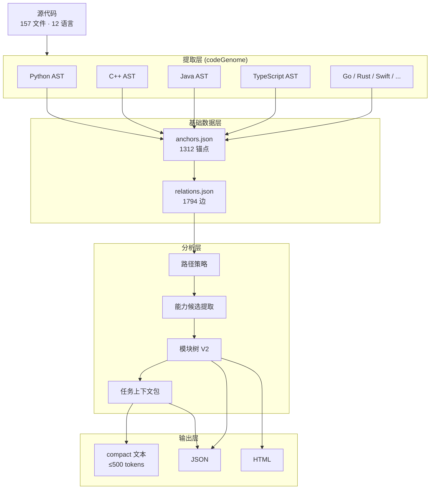

# CodeDendrite: 基于 AST 的代码因果导航系统

**用静态分析替代向量搜索，让 7B 小模型也能精确理解项目结构。**

---

## 总体架构



---

## 核心思路

传统 AI 编程工具用 **RAG + 向量搜索**：把代码切块 → 嵌入向量 → 相似度检索。问题是：

- 丢失了函数间的调用关系
- 检索结果没有因果解释
- 小模型拿到碎片后仍然在猜

CodeDendrite 用 **AST 静态分析**：

- 精确到函数/类/方法级别（不是文本块）
- 自动派生 5 种因果关系（call · dataflow · inherit · impact · dispatch）
- 按 token 预算分层投喂（不是塞一堆代码进去）

**结果：7B 模型拿到 400 tokens 的任务包，就能定位到正确的入口和候选。**

---

## 五种因果关系

| 类型 | 数量 | 含义 | 用途 |
|------|------|------|------|
| `call` | 631 | A 函数调用 B 函数 | 追踪执行路径 |
| `dataflow` | 924 | A 的输出流入 B 的输入 | 追踪数据来源 |
| `inherit` | 75 | 子类继承父类 | 理解类层级 |
| `impact` | 127 | 修改 A 会影响 B | 评估改动影响 |
| `dispatch` | 37 | A 分发/路由到 B | 追踪动态调度 |

---

## 数据流水线

```
源代码 → AST 解析 → 锚点提取 → 关系派生 → 路径策略 → 高层锚点检测 → 模块核生成 → 贪心合并 → 模块树 V2 → 任务上下文包
```

五个阶段：

| 阶段 | 输入 | 输出 | 说明 |
|------|------|------|------|
| 提取 | 源代码文件 | 符号 + 哈希 | AST 解析，精确到行号 |
| 索引 | 锚点 | anchors.json + relations.json | 1312 锚点，1794 边 |
| 分析 | 锚点 + 关系 | 282 能力候选 | 路径策略 + 高层检测 + 打分 |
| 合成 | 候选集 | 30 模块 · 41 边 | 贪心合并 + 四格填充 + 信心评级 |
| 投喂 | 模块树 + 查询 | task_context.json | 四级上下文，compact ~400 tokens |

---

## Module Tree V2

首次扫描即可输出项目级功能块导览图。

**不是**函数聚类 + 猜名字；**是**多证据合成 + 置信度评级。

### 模块四格

每个模块必须回答：

```
what:      这个模块做什么
how:       内部怎么实现的
functions: 关键入口和类
role:      对项目的贡献
```

### 状态与信心

| 状态 | 含义 |
|------|------|
| `core_flow` | 主链路必经模块 |
| `independent_capability` | 可独立调用的能力 |
| `support_utility` | 支撑工具 |
| `dormant` | 休眠/未接线 |
| `uncertain` | 证据不足 |

| 信心 | 条件 |
|------|------|
| A | ≥4 类证据一致 |
| B | ≥3 类证据 |
| C | 2 类证据 |
| D | <2 类证据 |

### 当前仓库实测

```
模块总数: 30
边数:     41
状态分布: 19 core_flow, 11 independent_capability
信心分布: 26 A, 4 B
区域覆盖: 15/15 (100%)
假模块:   0
```

---

## Task Context Packet

给小模型/执行 agent 一个当前任务的窄上下文。

### 四级上下文

| 级别 | 内容 | Token 预算 |
|------|------|-----------|
| L0 | 项目一句话 + 顶层区域 | 30-80 |
| L1 | 当前区域 + 模块摘要 | 100-300 |
| L2 | 3-7 个候选 + why + next_command | 300-800 |
| L3 | 源码片段（按需，默认不给） | 按需 |

### compact 输出示例

```
项目: CodeDendrite: 30 个功能模块 (19 core_flow, 11 independent_capability)
当前区域: api | 提供 create_anchor 等入口能力
任务锚点: api/anchors.py::create_anchor

候选:
  C0 create_anchor [任务目标] → expand api/anchors.py::create_anchor
  C1 Anchor [被任务调用 via call] → expand codeTree/anchor_engine.py::Anchor
  C2 generate_all_anchors [调用了任务 via call] → expand api/anchors.py::generate_all_anchors

边: create_anchor→Anchor(call), generate_all_anchors→create_anchor(call)
```

**总共 ~400 tokens，7B-4K 模型吃完后还剩 3.5K 上下文。**

---

## 快速开始

### 全链路生成

```bash
cd tools/CodeDendrite
PYTHONPATH=. python api/cli.py . --module-tree-v2
```

输出：
```
.codedendrite/capability_candidates.json   # 282 候选
.codedendrite/module_tree_v2.json          # 30 模块 · 41 边
.codedendrite/module_tree_v2.html          # 可搜索导览页
```

### Task Context Packet

```bash
# 生成并保存 JSON
PYTHONPATH=. python api/cli.py . --task-context create_anchor

# 直接输出 compact 文本（给小模型用）
PYTHONPATH=. python api/cli.py . --task-context-compact PythonExtractor
```

### 全部 CLI 命令

| 命令 | 作用 |
|------|------|
| `--module-tree-v2` | 全链路：候选 + 模块树 + HTML |
| `--capability-candidates` | 只生成候选集 |
| `--module-tree-v2-html` | 只渲染 HTML |
| `--module-tree-v2-check` | 检查完整性报告 |
| `--path-policy-check PATH` | 检查路径角色 |
| `--task-context QUERY` | 生成任务上下文包 |
| `--task-context-compact QUERY` | 输出 compact 文本 |

---

## 锚点数据结构

```python
@dataclass
class Anchor:
    id: str              # "file.py::symbol" 唯一标识
    symbol: str          # 符号名
    file: str            # 相对路径
    line_start: int      # 起始行
    line_end: int        # 结束行
    hash: str            # 结构哈希（秒级变更检测）
    callers: List[str]   # 调用者
    callees: List[str]   # 被调用者
    symbol_type: str     # function / class / method
    drift: str           # ok / stale / missing_symbol / missing_file
    # ... 继承、数据流、AI 记忆等字段
```

---

## 项目结构

```
tools/CodeDendrite/
├── api/                        # 公开 API 层
│   ├── anchors.py              # 锚点管理
│   ├── relations.py            # 关系管理
│   ├── path_policy.py          # 路径策略（三角色分类）
│   ├── capability_candidates.py # 能力候选提取
│   ├── module_tree_v2.py       # 模块树 V2 核心算法
│   ├── task_context_packet.py  # 任务上下文包
│   ├── analysis.py             # 符号搜索
│   └── cli.py                  # CLI 入口
├── codeGenome/                 # 多语言 AST 提取
├── codeTree/                   # 锚点引擎 + 深度分析
├── codeAnalysis/               # 多语言分析器（12 种语言）
├── inheritance/                # Python 继承追踪
├── cpp_inheritance/            # C++ 继承追踪
├── dataFlow/                   # 数据流分析
├── context_builder/            # 上下文构建器
├── anchorRepair/               # 锚点修复
├── anchorMemory/               # AI 记忆
├── pathTracer/                 # 路径追踪
├── smartAnalyzer/              # 智能分析器 V2
├── hash/                       # AST 哈希计算
├── shared/                     # 共享类型（Anchor dataclass）
├── visualize/                  # HTML 可视化
│   └── module_tree_v2.py       # 模块树可视化
├── tests/                      # 测试
│   ├── test_module_tree_v2_smoke.py   # 模块树测试 (20 项)
│   └── test_task_context_smoke.py     # 任务包测试 (24 项)
└── .codedendrite/              # 输出目录
    ├── anchors.json
    ├── relations.json
    ├── module_tree_v2.json
    ├── module_tree_v2.html
    ├── task_context.json
    └── capability_candidates.json
```

---

## 关键技术数据

| 指标 | 数值 |
|------|------|
| 支持语言 | 12 种（Python/Java/C++/TS/Go/Rust/Swift/Kotlin/Ruby/PHP/HTML/C#） |
| 锚点总数 | 1312（537 function + 647 method + 128 class） |
| 关系总数 | 1794（924 dataflow + 631 call + 127 impact + 75 inherit + 37 dispatch） |
| 源文件数 | 157 |
| 模块数 | 30（19 core_flow + 11 independent_capability） |
| 区域覆盖 | 15/15 (100%) |
| 模块树 JSON | ~99KB |
| 任务包 compact | ~400 tokens |

---

## 与 RAG 向量搜索的对比

| 维度 | RAG + 向量搜索 | CodeDendrite |
|------|---------------|-------------|
| 粒度 | 文本块 | 函数/类/方法 |
| 关系 | 无 | 5 种因果边 |
| 可解释性 | 相似度分数 | 证据链 + 置信度 |
| 增量更新 | 全量重建 | hash 增量检测 |
| 小模型投喂 | 原始代码片段 | 分层预算 compact 文本 |
| 模型依赖 | 需要 embedding model | 纯静态分析，零模型依赖 |

---

**License:** MIT
**更新:** 2026-04-25
